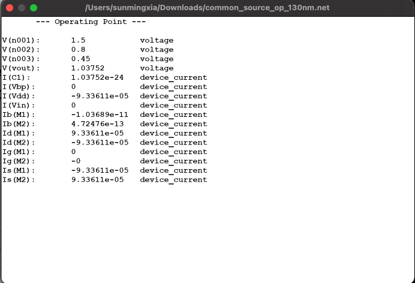
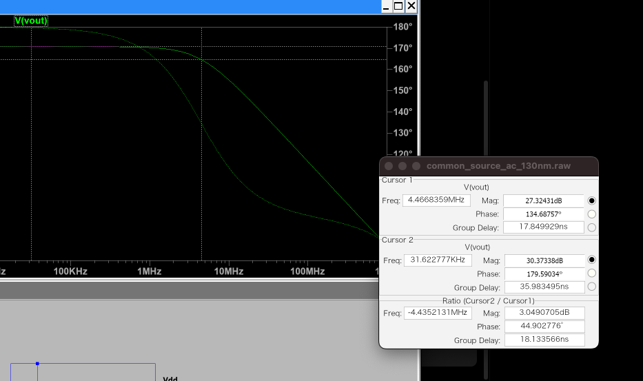
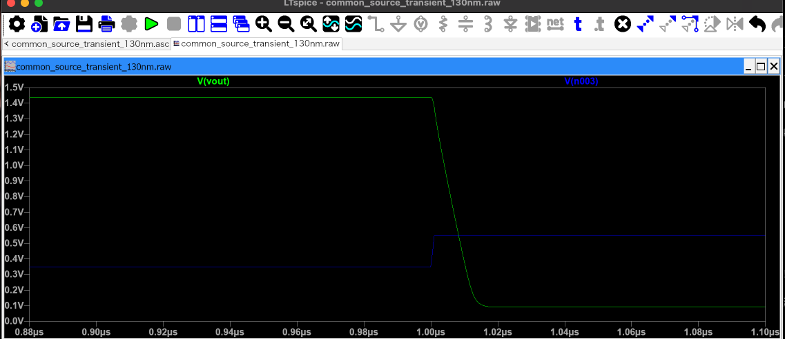

# Phase 3 — Common-Source Amplifier

This phase uses an NMOS common-source stage with a PMOS active load. I ran separate DC, AC and transient analyses in LTspice. It is a single-stage amplifier exercise, not a two-stage op-amp.

## Circuit

- M1: NMOS, W = 10 µm, L = 1 µm
- M2: PMOS, W = 10 µm, L = 1 µm
- VDD = 1.5 V
- PMOS gate bias, VBP = 0.8 V
- NMOS input bias = 0.45 V for DC and AC analyses
- Load capacitor, CL = 1 pF
- Temperature = 27 °C
- Device model: generic 130-nm BSIM3 (`nMOSFET` and `pMOSFET`)

## Results

| Measurement | Result |
|---|---:|
| Output DC voltage | 1.03752 V |
| Quiescent supply current | 93.3611 µA |
| Static power from VDD | 140.04 µW |
| Gain at 10 kHz | 30.37358 dB |
| −3 dB bandwidth (cursor estimate) | ≈ 4.47 MHz |
| Near-unity-gain point | 144.54398 MHz |
| Output rising slew rate | 69.8946 V/µs |
| Output falling slew rate | 104.849 V/µs |

The bandwidth estimate is based on a cursor reading at 4.4668359 MHz and 27.32431 dB, about 3.05 dB below the low-frequency gain. The near-unity-gain cursor reading was +0.0963 dB, so it is reported as a near-unity-gain point rather than an exact 0 dB crossing.

The slew rates are average slopes measured between cursor points over the 20–80% and 80–20% portions of the output transition. They are not peak values of the numerical derivative.

## Simulation screenshots

### DC operating point

*LTspice operating-point log showing the output voltage and device currents.*

### AC response

*Gain and phase response across the simulated frequency range.*

### Transient response

*Input pulse and corresponding inverted output waveform.*

## Source files

- [DC operating-point schematic (.asc)](https://raw.githubusercontent.com/Marumo66/Current-Mirror-Design/main/Phase_3_Common_Source_Amplifier/schematics/common_source_op_130nm.asc)
- [AC analysis schematic (.asc)](https://raw.githubusercontent.com/Marumo66/Current-Mirror-Design/main/Phase_3_Common_Source_Amplifier/schematics/common_source_ac_130nm.asc)
- [Transient analysis schematic (.asc)](https://raw.githubusercontent.com/Marumo66/Current-Mirror-Design/main/Phase_3_Common_Source_Amplifier/schematics/common_source_transient_130nm.asc)

To run a schematic, keep the repository folder structure and place the separately obtained `cmos130.lib` file in `models/`. The ASC files reference it using `../models/cmos130.lib`. The model is not included because redistribution permission has not been confirmed.

## Files

- `schematics/common_source_op_130nm.asc` — DC operating-point setup.
- `schematics/common_source_ac_130nm.asc` — AC sweep setup.
- `schematics/common_source_transient_130nm.asc` — pulse-response setup.
- `results/data/measurements.csv` — measured values.
- `results/data/measurement_notes.md` — cursor readings, calculations and limitations.
- `screenshots/README.md` — screenshot notes.
- `models/README.md` — notes about the external model file.
- `simulation/README.md` — how to run the three analyses.

## Notes

The three analysis schematics were run in LTspice using the supplied generic model. LTspice reported that the model specifies BSIM3 version 3.200 while the simulator supports version 3.3.0. It also reported PD = 0 and PS = 0 warnings. The model was left unchanged.

This is a generic model, not a foundry-qualified PDK. The results describe this simulation setup and should not be treated as predictions for silicon. No phase-margin value is reported: phase margin is a loop-stability metric and was not measured for this open-loop common-source stage.
