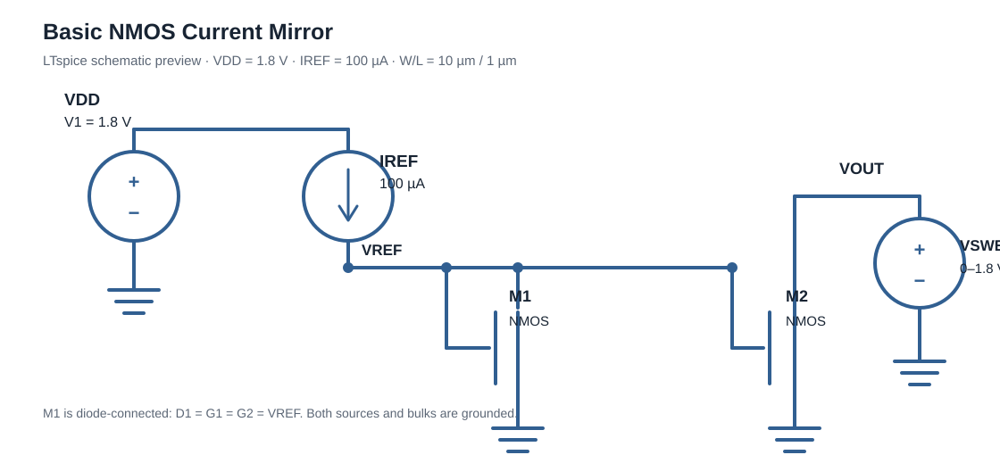

# CMOS Current Mirror Design

I built a basic NMOS current mirror in LTspice and used it to look at two questions:

- How does the output current change when I sweep the output voltage?
- What changes when channel-length modulation is enabled or disabled in the MOSFET model?

This repository contains the LTspice schematics and netlists, model cards, selected simulation readings, calculations and a short report.

## Phase 1 — Basic NMOS current mirror
### Phase 1 source schematics

- [Current mirror with LAMBDA = 0 (.asc)](https://raw.githubusercontent.com/Marumo66/Current-Mirror-Design/main/Phase_1_Basic_Current_Mirror/schematics/Basic_Current_Mirror_Lambda0.asc)
- [Current mirror with LAMBDA = 0.02 (.asc)](https://raw.githubusercontent.com/Marumo66/Current-Mirror-Design/main/Phase_1_Basic_Current_Mirror/schematics/Basic_Current_Mirror_Lambda002.asc)


### Circuit



### Setup

| Parameter | Value |
|---|---:|
| Supply voltage | 1.8 V |
| Reference current | 100 µA |
| M1 and M2 width | 10 µm |
| M1 and M2 length | 1 µm |
| Threshold voltage (model) | 0.7 V |
| KP (model) | 200 µA/V² |
| LAMBDA | 0.02 V⁻¹ or 0 |
| Output-voltage sweep | 0–1.8 V, 0.01 V step |

The two runs use the same circuit and bias conditions. The only model parameter changed between them is LAMBDA.

### Results

- With LAMBDA = 0.02, the measured output current at VOUT = 1.8 V was 101.5426 µA. This is a +1.5426% difference from the 100 µA reference current.
- With LAMBDA = 0, the measured current was approximately 100 µA at the three sampled saturation-region points: 0.5 V, 1.0 V and 1.8 V.
- The output resistance estimated from the LAMBDA = 0.02 sweep was about 510 kΩ. This is close to the value calculated from the LTspice operating-point Gds reading.

### Selected LTspice readings


These are selected cursor readings from the LTspice plots, not the full sweep data.

## Files

- `Phase_1_Basic_Current_Mirror/schematics/` — the two LTspice `.asc` files used for the DC sweeps.
- `Phase_1_Basic_Current_Mirror/models/` — the two Level-1 model cards.
- `Phase_1_Basic_Current_Mirror/simulation/netlists/` — netlists for the operating-point and DC-sweep runs.
- `Phase_1_Basic_Current_Mirror/results/data/` — cursor readings and operating-point values copied from LTspice.
- `Phase_1_Basic_Current_Mirror/results/figures/` — comparison plot.
- `Phase_1_Basic_Current_Mirror/analysis/` — calculations and notes.
- `Phase_1_Basic_Current_Mirror/report/` — the Phase 1 report.

The two `.asc` files in `Phase_1_Basic_Current_Mirror/schematics/` are the versions saved from the LTspice session. Each one runs a DC sweep with its own LAMBDA setting. The separate `.cir` files also include the operating-point runs.

## Notes and limitations

I used a simple Level-1 NMOS model with illustrative parameters. It is not a model for a specific foundry process. LTspice also warned that the chosen transistor dimensions were outside its recommended range for this model. The simulations converged, but the results should be treated as a study of the model's behaviour rather than predictions for a real chip.

The values in the CSV files were read from selected LTspice cursor and operating-point screenshots. They are rounded to the precision shown by LTspice. The raw screenshots are not included because they show local computer paths and a username.

To regenerate the comparison plot from the CSV file, install Matplotlib and run:

```bash
python3 -m pip install matplotlib
python3 scripts/plot_results.py
```

The script plots the saved cursor readings. It does not run LTspice or recreate the full sweep.


## Phase 2 — 130-nm current mirror comparison
### Phase 2 source schematics

- [Basic 130-nm current mirror (.asc)](https://raw.githubusercontent.com/Marumo66/Current-Mirror-Design/main/Phase_2_130nm_Current_Mirror_Comparison/schematics/basic_current_mirror_130nm.asc)
- [Cascode 130-nm current mirror (.asc)](https://raw.githubusercontent.com/Marumo66/Current-Mirror-Design/main/Phase_2_130nm_Current_Mirror_Comparison/schematics/cascode_current_mirror_130nm.asc)

The Phase 2 schematics reference the external `cmos130.lib` model. It is not included in this public repository because redistribution permission has not been confirmed. See the Phase 2 model notes for details.


I then used a generic 130-nm BSIM3 model to compare a basic NMOS current mirror with a four-transistor self-biased cascode version. Both circuits use a 1.5 V supply and a 100 µA reference current.

Over the 0.5–1.5 V measurement interval, the cascode circuit reduced the measured output-current variation from 7.03% to 0.96%. The interval output-resistance estimate changed from 142.17 kΩ to 1.041 MΩ. These resistance values are estimated from the DC sweep endpoints, not from a small-signal operating-point measurement.

The Phase 2 schematics, measurement logs, calculations and model notes are in [Phase_2_130nm_Current_Mirror_Comparison](Phase_2_130nm_Current_Mirror_Comparison/README.md). The generic model file is not included because its redistribution terms have not been confirmed.


## Phase 3 — Common-source amplifier
### Phase 3 source files

The LTspice source files are available individually:

- [DC operating-point schematic (.asc)](https://raw.githubusercontent.com/Marumo66/Current-Mirror-Design/main/Phase_3_Common_Source_Amplifier/schematics/common_source_op_130nm.asc)
- [AC analysis schematic (.asc)](https://raw.githubusercontent.com/Marumo66/Current-Mirror-Design/main/Phase_3_Common_Source_Amplifier/schematics/common_source_ac_130nm.asc)
- [Transient analysis schematic (.asc)](https://raw.githubusercontent.com/Marumo66/Current-Mirror-Design/main/Phase_3_Common_Source_Amplifier/schematics/common_source_transient_130nm.asc)

To run them in LTspice, download or clone the repository and keep its folder structure. The schematics look for the model at `Phase_3_Common_Source_Amplifier/models/cmos130.lib` (relative to the `schematics/` folder). The model card is not included in this public repository because permission to redistribute it has not been confirmed.

The model copy checked during preparation has SHA-256:

`ac9aa8376dd3fb9cf7033e8791b9f76ae07bf2c809d2148e1a1662e5bb07b1c3`

On macOS, verify a separately obtained copy with:

```bash
shasum -a 256 Phase_3_Common_Source_Amplifier/models/cmos130.lib
```


I built a common-source stage with a PMOS active load and checked its DC operating point, AC response and transient response in LTspice. The recorded results include a 32.22 dB gain at 10 kHz, a 9.33 MHz −3 dB bandwidth, a near-0 dB point at about 144.54 MHz, and cursor-based rising/falling slew-rate measurements.

The schematics, measurements and model notes are in [Phase 3 — Common-Source Amplifier](Phase_3_Common_Source_Amplifier/README.md). The model file itself is not included because its redistribution terms have not been confirmed.
