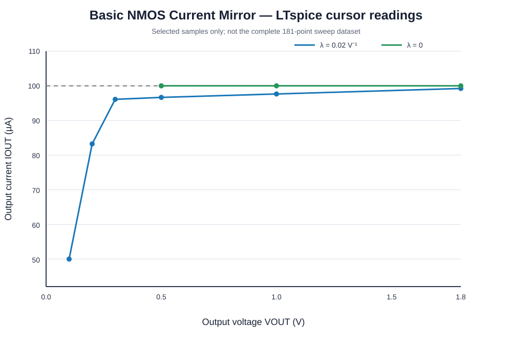

# CMOS Current Mirror Design

I built a basic NMOS current mirror in LTspice and used it to look at two questions:

- How does the output current change when I sweep the output voltage?
- What changes when channel-length modulation is enabled or disabled in the MOSFET model?

This repository contains the LTspice schematics and netlists, model cards, selected simulation readings, calculations and a short report.

## Phase 1 — Basic NMOS current mirror

### Circuit


### Setup

| Parameter | Value |
|---|---:|
| Supply voltage | 1.8 V |
| Reference current | 100 µA |
| M1 and M2 width | 10 µm |
| M1 and M2 length | 1 µm |
| Threshold voltage (model) | 0.7 V |
| KP (model) | 200 µA/V² |
| LAMBDA | 0.02 V⁻¹ or 0 |
| Output-voltage sweep | 0–1.8 V, 0.01 V step |

The two runs use the same circuit and bias conditions. The only model parameter changed between them is LAMBDA.

### Results

- With LAMBDA = 0.02, the measured output current at VOUT = 1.8 V was 101.5426 µA. This is a +1.5426% difference from the 100 µA reference current.
- With LAMBDA = 0, the measured current was approximately 100 µA at the three sampled saturation-region points: 0.5 V, 1.0 V and 1.8 V.
- The output resistance estimated from the LAMBDA = 0.02 sweep was about 510 kΩ. This is close to the value calculated from the LTspice operating-point Gds reading.

### Selected LTspice readings



These are selected cursor readings from the LTspice plots, not the full sweep data.

## Files

- `Phase_1_Basic_Current_Mirror/schematics/` — the two LTspice `.asc` files used for the DC sweeps.
- `Phase_1_Basic_Current_Mirror/models/` — the two Level-1 model cards.
- `Phase_1_Basic_Current_Mirror/simulation/netlists/` — netlists for the operating-point and DC-sweep runs.
- `Phase_1_Basic_Current_Mirror/results/data/` — cursor readings and operating-point values copied from LTspice.
- `Phase_1_Basic_Current_Mirror/results/figures/` — comparison plot.
- `Phase_1_Basic_Current_Mirror/analysis/` — calculations and notes.
- `Phase_1_Basic_Current_Mirror/report/` — the Phase 1 report.

The two `.asc` files in `Phase_1_Basic_Current_Mirror/schematics/` are the versions saved from the LTspice session. Each one runs a DC sweep with its own LAMBDA setting. The separate `.cir` files also include the operating-point runs.

## Notes and limitations

I used a simple Level-1 NMOS model with illustrative parameters. It is not a model for a specific foundry process. LTspice also warned that the chosen transistor dimensions were outside its recommended range for this model. The simulations converged, but the results should be treated as a study of the model's behaviour rather than predictions for a real chip.

The values in the CSV files were read from selected LTspice cursor and operating-point screenshots. They are rounded to the precision shown by LTspice. The raw screenshots are not included because they show local computer paths and a username.

To regenerate the comparison plot from the CSV file, install Matplotlib and run:

```bash
python3 -m pip install matplotlib
python3 scripts/plot_results.py
```

The script plots the saved cursor readings. It does not run LTspice or recreate the full sweep.
