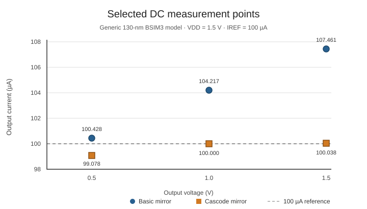
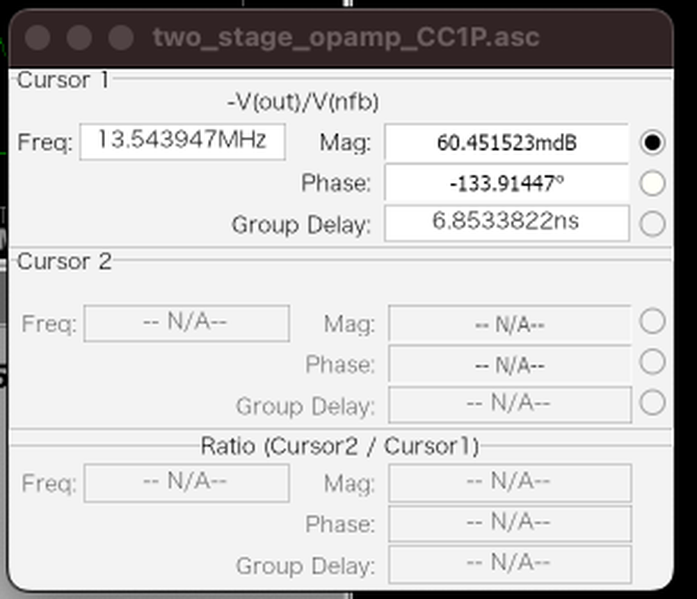

# CMOS Analog Circuit Studies

**LTspice-based circuit design and simulation | CMOS current mirrors, amplifiers and op-amps**

This is my personal analog IC study project. I started with a basic NMOS current mirror, looked at how channel-length modulation affects its accuracy, then compared it with a self-biased cascode mirror. After that I built a common-source stage and a two-stage CMOS op-amp.

I keep the LTspice schematics, simulation setups, measured values and calculations together in the repository. The aim is to understand how the circuits behave and to keep the results traceable, rather than just collect schematic screenshots.

## Project at a glance

| Stage | Circuit | Main work |
|---|---|---|
| [01 — Basic current mirror](Phase_1_Basic_Current_Mirror/README.md) | Two-transistor NMOS mirror | Channel-length modulation, current mismatch and output resistance |
| [02 — Cascode comparison](Phase_2_130nm_Current_Mirror_Comparison/README.md) | Basic and self-biased cascode mirrors | Output-current variation and output-resistance comparison |
| [03 — Common-source amplifier](Phase_3_Common_Source_Amplifier/README.md) | NMOS common-source with PMOS active load | DC operating point, AC gain, bandwidth and transient response |
| [04 — Two-stage CMOS op-amp](Phase_4_Two_Stage_Operational_Amplifier/README.md) | Differential input stage and common-source second stage | Miller compensation, loop gain, phase margin, bandwidth and slew-rate measurements |

## Results I found interesting

These are the main numbers from the LTspice runs documented in the project. They belong to the specific circuits, models and test conditions listed in each phase.

| Circuit | Measurement | Result |
|---|---|---:|
| Basic NMOS mirror, LAMBDA = 0.02 | Output current at VOUT = 1.8 V, IREF = 100 µA | 101.5426 µA (+1.54%) |
| Basic NMOS mirror, LAMBDA = 0.02 | Output resistance estimated from the DC sweep | ≈ 510 kΩ |
| Basic vs. cascode mirror | Current variation from 0.5–1.5 V | 7.03% vs. 0.96% |
| Basic vs. cascode mirror | Interval output-resistance estimate | 142.17 kΩ vs. 1.041 MΩ |
| Common-source stage | Gain at 10 kHz / approximate −3 dB bandwidth | 30.37 dB / 4.47 MHz |
| Two-stage CMOS op-amp | Low-frequency return-ratio gain | 79.58 dB |
| Two-stage CMOS op-amp | Cursor-based UGBW / phase margin | ≈ 13.54 MHz / ≈ 46.09° |
| Two-stage CMOS op-amp | 500 mV-step average rising / falling output slope | 10.84 / 3.93 V/µs |

### Basic mirror vs. cascode mirror

The Phase 2 comparison was the clearest result in the project. Over the 0.5–1.5 V output-voltage interval, the measured current variation dropped from 7.03% for the basic mirror to 0.96% for the self-biased cascode version.



The output-resistance figures in the table are estimates from the DC sweep endpoints, not small-signal values extracted from operating-point Gds. The full measurement conditions and calculations are in the [Phase 2 notes](Phase_2_130nm_Current_Mirror_Comparison/results/data/measurement_notes.md).

### Two-stage CMOS op-amp

The current op-amp testbench uses an NMOS differential pair with a PMOS current-mirror active load, followed by a common-source second stage. I used a Miller capacitor and a series nulling resistor for compensation.



The UGBW and phase-margin values are cursor readings close to the 0 dB crossing. The measured core power is based on VDD current only; power from the ideal bias sources is not included. More details are in the [Phase 4 report](Phase_4_Two_Stage_Operational_Amplifier/README.md).

## What I worked on

- Built and simulated NMOS current mirrors, including a four-transistor self-biased cascode version.
- Compared idealised and non-ideal current-mirror behaviour by changing the Level-1 model's channel-length modulation parameter.
- Checked MOSFET operating points and used DC sweeps to estimate current mismatch and output resistance.
- Built an NMOS common-source stage with a PMOS active load and checked its DC, AC and transient responses.
- Put together a two-stage CMOS op-amp with Miller compensation and examined its return ratio, unity-gain bandwidth, phase margin and large-signal response.
- Recorded LTspice readings in CSV and Markdown, and used a small Python script to plot the selected current-mirror measurements.

## Tools and models

- **LTspice 26.0.2** — schematic capture, DC operating-point analysis, DC sweeps, AC analysis and transient simulation.
- **MOSFET models** — a simple Level-1 NMOS model for Phase 1 and a generic 130-nm BSIM3 model for Phases 2–4.
- **Python 3 + Matplotlib** — plotting the saved Phase 1 cursor readings from CSV.

The generic 130-nm model is not a foundry-qualified PDK. I have not included `cmos130.lib` because I have not confirmed its redistribution terms. To run Phases 2–4, obtain the model from its original source and place it in the relevant `models/` folder as described in that phase's model README.

## Reproducing the simulations

1. Clone or download the repository.
2. Open the required `.asc` file in LTspice 26.0.2.
3. For Phase 1, the model directives are included in the schematics.
4. For Phases 2–4, place your permitted copy of `cmos130.lib` in the corresponding `models/` folder.
5. Keep the folder structure unchanged so the relative model include paths continue to work.

Each phase has its own run notes:

- [Phase 1 — schematics and netlists](Phase_1_Basic_Current_Mirror/README.md)
- [Phase 2 — mirror comparison](Phase_2_130nm_Current_Mirror_Comparison/README.md)
- [Phase 3 — common-source amplifier](Phase_3_Common_Source_Amplifier/simulation/README.md)
- [Phase 4 — two-stage op-amp](Phase_4_Two_Stage_Operational_Amplifier/simulation/README.md)

To regenerate the Phase 1 comparison plot from the saved CSV readings:

```bash
python3 -m pip install matplotlib
python3 scripts/plot_results.py
```

That script only plots the selected readings already stored in the CSV. It does not launch LTspice or recreate the original simulation sweep.

## Repository layout

```text
Phase_1_Basic_Current_Mirror/
    schematics/       LTspice schematics
    simulation/       DC and operating-point netlists
    analysis/         Calculations and experiment notes
    results/          CSV readings and plots
    report/           Technical write-up

Phase_2_130nm_Current_Mirror_Comparison/
    schematics/       Basic and cascode mirror
    simulation/       Measurement directives
    models/           External model instructions
    results/          Measurements, calculations and plot

Phase_3_Common_Source_Amplifier/
    schematics/       DC, AC and transient setups
    simulation/       Run instructions
    models/           External model instructions
    results/          Measurements
    screenshots/      LTspice screenshots

Phase_4_Two_Stage_Operational_Amplifier/
    schematics/       DC, AC loop-gain and transient setups
    simulation/       Run instructions
    models/           External model instructions
    results/          Measurements and calculations
    screenshots/      LTspice screenshots

scripts/
    plot_results.py   Plot the saved Phase 1 cursor readings
```

## Current limitations and next steps

There are still a few things I would like to improve:

- **Current mirrors:** check the minimum output voltage needed to keep current error within a chosen limit, and compare small-signal output resistance using operating-point Gds.
- **Common-source stage:** rerun the three split ASC files and confirm that the saved measurements can be reproduced from the repository copies.
- **Two-stage op-amp:** replace the ideal VTAIL and VBN2 bias sources with a transistor-level bias circuit, then revisit the operating point and performance.
- **Model quality:** repeat the key comparisons with a model whose process assumptions and operating range are better documented.

A few points are important when reading the current results:

- Phase 1 uses illustrative Level-1 model parameters, not a process-specific model.
- The 130-nm BSIM3 model used in Phases 2–4 is generic, not a foundry-qualified PDK. LTspice reported a BSIM3 version warning and PD/PS warnings; I left the model unchanged.
- Some measurements are selected cursor readings or values copied from LTspice output logs, not complete exported waveform datasets. The phase notes identify the source of each value.
- In Phase 3, the separate DC, AC and transient ASC files were prepared from the submitted schematic but were not rerun after being split.
- The Phase 4 UGBW and phase margin are cursor-based estimates. Its VDD-only power number excludes the ideal bias sources.

These are simulation results for the stated setups. They are useful for comparing circuit behaviour, but they are not silicon measurements or a claim of foundry-level sign-off.
